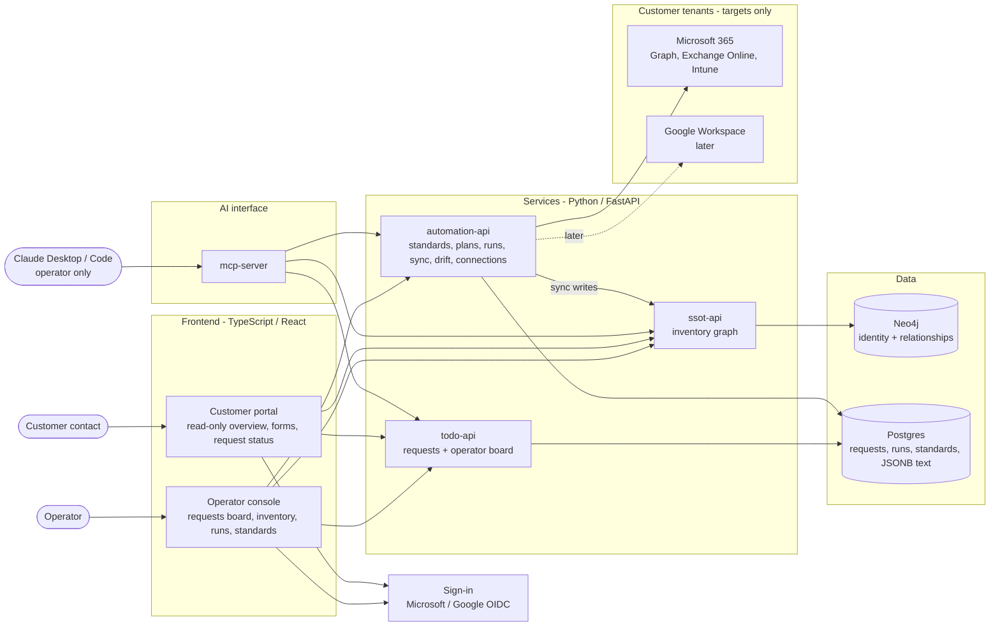
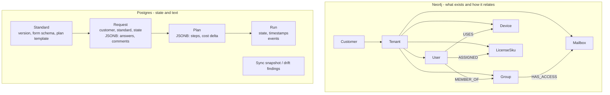
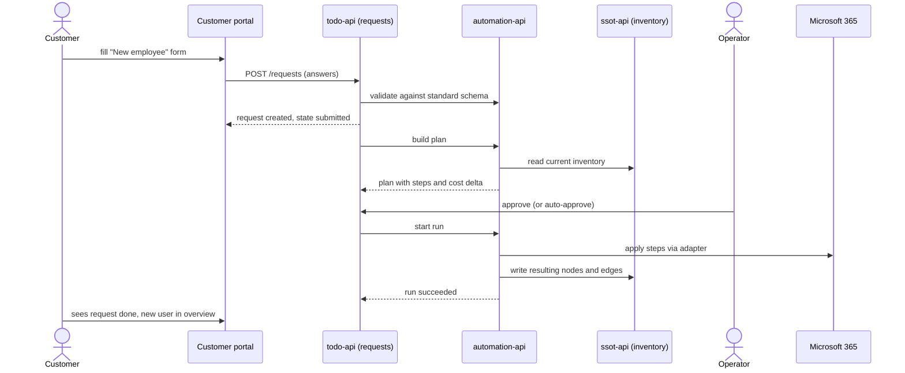

# yani architecture

Living document. Grows as decisions are made. The product itself is described in
`docs\vision.md`; this document is how it is built.

## 1. System overview

Every box is a container in one `docker compose` stack. Same images in dev and prod.



Component names are the current folder names. `ssot-api` is the inventory, `todo-api` holds
requests. Renaming is a roadmap item, not a prerequisite.

## 2. Roles, sign-in and tenant isolation

There is authentication. Two roles, one rule: a customer token can only ever reach its own
customer's data, enforced in the services, not in the UI.

- **Sign-in:** OpenID Connect against Microsoft (and Google later). Customers sign in with their
  own work account. Operators sign in with an account in the operator's own tenant.
- **Mapping:** the token's tenant ID (`tid`) maps to exactly one `customer_id`. An operator is
  recognised by tenant ID plus an allow-list of operator accounts, not by anything in the
  customer's tenant.
- **Services:** every API validates the JWT itself via the issuer's JWKS. No shared session
  store, no auth bypass flags, no "dev mode without auth". Dev uses a real test tenant.
- **Scoping:** every customer-owned row and node carries `customer_id`. Customer requests are
  filtered by the `customer_id` from the token server-side; a `customer_id` from the URL or body
  is never trusted for a customer token.
- **Customer permissions:** read inventory, read cost and health, list published forms, submit a
  form, read own requests. Nothing else.
- **Claude / MCP:** operator only, bound to an operator identity. Never exposed to customers.

## 3. Reaching customer tenants

Yani acts on a customer tenant with its own credentials, never the customer's sign-in.

- Microsoft 365: one multi-tenant app registration, admin-consented per customer with application
  permissions (Graph for users, groups, licenses, Intune; Exchange Online for mailboxes, because
  shared mailboxes and mailbox permissions are not fully covered by Graph). GDAP through Partner
  Center is the alternative if we resell licenses. Open, see section 10.
- Google Workspace, later: a service account with domain-wide delegation per customer.
- Each tenant is a **connection**: kind, config, encrypted secret, test endpoint.

All tenant calls go through **adapters** in `automation-api` with one interface per capability
(users, groups, mailboxes, devices, licenses). Standards speak to the interface, never to Graph
directly, which is what makes Google a second adapter and not a rewrite.

### Connections and secrets

| kind | config | secret | test |
|---|---|---|---|
| `m365` | `{tenant_id, app_id}` | client secret or certificate | token request + `GET /organization`, returns tenant name |
| `google` (later) | `{customer_id, admin_email}` | service account key | directory read, returns domain |

Rules:

1. Secrets are write-only over the API. Reads return `secret_set` and a four character hint.
2. `PATCH`: field absent means unchanged, `""` means clear.
3. Never logged, never in a run event or error. The event writer scrubs known secret values.
4. Encrypted at rest with Fernet, key from `YANI_SECRET_KEY`.

## 4. Data ownership

Every entity has exactly one home store. Other stores hold only its ID. ULIDs everywhere.



- **Neo4j** holds the inventory: nodes with stable ID, external ID (the Graph object ID), name,
  type, `customer_id` and the minimal properties needed for queries and the overview (enabled,
  compliant, SKU). No payloads, no history. The label and edge catalog in `ssot-api` is the single
  place the model is defined; the current MSP-era set is the starting point.
- **Postgres** holds standards, requests, plans, runs, run events, connections, sync snapshots and
  drift findings. Structured fields as columns, text as JSONB.
- License prices are not exposed by the tenant APIs. Price per SKU is our own data (list price or
  agreed price per customer) in Postgres.

## 5. Standards and forms

A standard is one versioned definition with two halves:

- **Form:** a JSON schema of business inputs (name, department, start date, needs laptop). The
  customer portal renders forms generically from the schema. No per-form UI code.
- **Plan template:** turns validated answers plus current inventory into an ordered list of steps
  against the adapter interface, each with a cost effect.

```
standard: shared-mailbox v3
  form:   {display_name, owner_user_id, members[]}
  plan:   create mailbox (shared, no license, sign-in blocked)
          create group "MBX-<name>-Access"
          grant group FullAccess + SendAs on mailbox
          add members to group
          set owner
          enable mailbox auditing
  checks: mailbox has no license, sign-in blocked, access only via group, owner set
```

The `checks` are what drift detection evaluates. A standard is published per customer; a customer
sees only the forms that are published to them. Old requests keep the version they ran with.

Templates stay data plus a small, fixed set of step types implemented in code. No general
scripting language inside standards.

## 6. Request flow



Request states: `submitted` -> `planned` -> `approved` -> `running` -> `done` | `failed` |
`rejected` | `cancelled`. On the operator console a request is a card on the board; the board
columns are the states the operator works in. The customer only ever sees the state, not the
board.

## 7. Sync and drift

- A scheduled sync per connection reads users, groups, mailboxes, devices and license assignments
  and reconciles them into the inventory graph (create, update, remove nodes and edges by external
  ID).
- After sync, every published standard's checks run against the inventory. Failures become drift
  findings with a plain-language text for the customer and a suggested fix plan for the operator.
- Fixing drift is a normal plan and run. Nothing is auto-fixed in the first version.

## 8. Execution

`automation-api` owns plans, runs and the worker.

- **Runs table is the queue.** One asyncio worker claims with `SELECT ... FOR UPDATE SKIP LOCKED`,
  concurrency from config. No broker, no Celery. Prefect only if scheduling outgrows this.
- **Run events** are append-only (`seq`, `at`, `kind`, `payload`), polled with `after=seq`; SSE
  later is a transport change.
- **Executor seam:** `Executor.run(run, emit) -> Result`. `MockExecutor` first, so the whole path
  is real end to end before any tenant is touched. The real executor walks plan steps through the
  adapters.
- Steps are idempotent where the target allows it (look up by external ID before creating), so a
  failed run can be retried.

## 9. AI interface

`mcp-server` is a thin adapter for the operator: MCP tools in, the REST APIs out, using the
operator's identity. Tools: search inventory, inspect a user or tenant, list and comment requests,
show a plan, approve, inspect runs and drift. No model calls inside yani itself; Claude Desktop or
Code is the client and rides the operator's subscription.

## 10. Open

- Tenant access: multi-tenant app consent vs GDAP via Partner Center (depends on whether we resell
  licenses).
- Exchange Online from a container: REST-backed PowerShell module vs the EXO admin API, for
  shared mailboxes and mailbox permissions.
- Customer portal as its own app vs a role-based view of the operator console. Leaning: own app,
  because the customer surface is small and must never ship operator code paths.
- Renaming `ssot-api` / `todo-api` to `inventory-api` / `request-api`.
- Where standards are authored: in the operator console, or as files in the repo loaded at
  startup.
- Reverse proxy in front once there is a public customer portal (TLS, one origin).
- Attachments (MinIO) and outgoing mail (Mailpit in dev) for request notifications.
